# MER — Modelo Entidade-Relacionamento (Conceitual e Lógico)

Este documento define o **Modelo Entidade-Relacionamento (MER)** completo do PWA **Perdidos e Achados & Guarda-Volumes**, derivado diretamente da planilha `Perdidos e Achados (Guarda-Volumes).xlsx`, do aplicativo Glide de referência, do formulário `Relatório Final - Após o Evento` (Salão de Assembleias — Guarapari/ES) e das orientações oficiais (§54–58).

---

## 1. Diagrama Entidade-Relacionamento Completo

```mermaid
erDiagram
    EVENTO ||--o{ ITEM : "agrupa (1:N)"
    EVENTO ||--o{ ITEM_PROCURADO : "registra (1:N)"
    EVENTO ||--o| RELATORIO_FINAL : "consolida (1:1)"
    ITEM ||--|{ RASTREIO_EVENTO : "audita_ciclo_vida (1:N)"
    ITEM }o--o{ ITEM_PROCURADO : "provavel_correspondencia (N:M)"
    TIPO_ITEM_CATALOGO ||--o{ ITEM : "categoriza (1:N)"
    CONFIG_DISPOSITIVO ||--o{ SYNC_LOG : "registra_trocas (1:N)"
    CONFIG_DISPOSITIVO ||--o{ ITEM : "origina_em (1:N)"

    EVENTO {
        string id PK "UUID ou fk_id_Eventos (Glide)"
        string tipo "Assembleia | Congresso | Reuniao Especial"
        string codigo "Ex.: ES-005.27.1 | CO-2027"
        string circuito "Ex.: ES-005"
        string parte "A | B | Unica | vazio"
        date data "YYYY-MM-DD (Evento Data)"
        string local "Salao de Assembleias — Guarapari/ES"
        string superintendente "Nome do encarregado/superintendente"
        string ajudantes "Nomes dos ajudantes"
        int voluntariosNecessarios "Qtd prevista"
        int voluntariosUsados "Qtd efetiva"
        int proximaEtiqueta "Sequencia automatica por evento"
        string status "ativo (ABRIR) | encerrado (FECHAR somente leitura)"
        datetime createdAt "ISO-8601"
        datetime updatedAt "ISO-8601"
        string deviceId FK "Equipamento criador"
    }

    ITEM {
        string id PK "UUID ou Row ID (Glide)"
        string eventoId FK "Ref EVENTO.id"
        int etiqueta "Numero sequencial inteiro no evento"
        string etiquetaCodigo "Codigo exibido (ex.: 01 ou B-01)"
        string etiquetaOrigem "Preserva codigo original em renumeracao de merge"
        int formPagina "Form Pagina (folha onde a 2a etiqueta gemea e colada)"
        string tipoItem "Ref catalogo ou tipo livre"
        string descricao "Descricao detalhada do item ou pessoa"
        string valor "Baixo | Comum | Medio | Alto | Precioso"
        string categoria "Perdido | Guardado | Crianca | Idoso | Adulto"
        text fotoEntrada "Foto 1 (DataURL JPEG comprimido ou URL) — Item com etiqueta"
        boolean etiquetaConfirmadaNoItem "Check: 1a etiqueta aplicada no objeto"
        boolean etiquetaConfirmadaNoFormulario "Check: 2a etiqueta gemea no formulario"
        text fotoEtiqueta "Foto 2 (DataURL) — Etiqueta no formulario / comprovante"
        text fotoEntrega "Foto 3 (DataURL opcional) — Comprovante de entrega"
        string status "Ainda Guardado | Em Conferencia | Ja Entregue | DESPACHADO"
        string destino "vazio | DESCARTAR | DOAR | VENDER | CONTAS"
        datetime dataHoraGuardado "Data-Hora-Guardado (ISO-8601)"
        string quemTrouxe "Quem-Trouxe-Nome-Tels"
        string localAchado "Local onde foi encontrado ou Balcao GV"
        string recebidoPor "Voluntario que recebeu"
        datetime dataHoraDespachado "Data-Hora-Despachado (ISO-8601)"
        string quemPegou "Quem-Pegou-Nome-Tels | SA | Depto Contas"
        string entreguePor "Voluntario que entregou/despachou"
        string observacaoEntrega "Detalhes da conferencia/entrega"
        string donoNomeTels "Dono-Nome-Tels (obrigatorio GV nao-roupa §58)"
        string congregacao "Congregacao do dono"
        string endereco "Endereco do dono"
        string deviceId FK "Equipamento de origem"
        string deviceName "Nome amigavel do equipamento"
        datetime createdAt "ISO-8601"
        datetime updatedAt "ISO-8601"
    }

    RASTREIO_EVENTO {
        string id PK "trk_*"
        string itemId FK "Ref ITEM.id (embedded array)"
        datetime timestamp "ISO-8601 cronologico"
        string etapa "RECEBIDO | ETIQUETADO | FOTO_REGISTRADA | CONFERENCIA | VINCULADO_PROCURADO | TRANSFERIDO_DISPOSITIVO | RETIDO_ALERTA | ENTREGUE | ENTREGUE_CONTAS | DESPACHADO_SA | REABERTO | EDITADO"
        string titulo "Resumo legivel da etapa"
        string detalhes "Descricao auditavel da ocorrencia"
        string operador "Nome do voluntario/SA"
        string dispositivo "Celular/PC que executou a acao"
        string localizacao "Mesa Exposicao | Cofre §55 | Prateleira GV | Contas | SA"
    }

    ITEM_PROCURADO {
        string id PK "prc_*"
        string eventoId FK "Ref EVENTO.id"
        string nomeTelefone "Nome e telefone de quem procura"
        string congregacao "Congregacao do solicitante"
        string descricao "Descricao detalhada do item procurado"
        text foto "Foto de referencia (ex.: WhatsApp)"
        string[] provaveisItensIds FK "Lista N:M de ITEM.id candidatos"
        string status "PROCURANDO | LOCALIZADO | ENTREGUE | CANCELADO"
        datetime createdAt "ISO-8601"
        datetime updatedAt "ISO-8601"
        string deviceId FK "Equipamento criador"
        string deviceName "Nome amigavel"
    }

    RELATORIO_FINAL {
        string id PK "rel_*"
        string eventoId FK "Ref EVENTO.id (UNIQUE)"
        string circuito "Ex.: ES-005"
        string eventoTipo "Assembleia | Congresso"
        string parte "A | B | vazio"
        date data "Data do evento"
        string departamento "Perdidos e Achados / Guarda Volume"
        string salaoAssembleias "Cabecalho ANEXO 1 (ex.: Guarapari)"
        string superintendente "Nome"
        string ajudantes "Nomes"
        int voluntariosNecessarios "Inteiro"
        int voluntariosUsados "Inteiro"
        boolean dificuldadeAntes "SIM/NAO"
        text dificuldadeAntesTexto "Detalhes"
        boolean dificuldadeDurante "SIM/NAO"
        text dificuldadeDuranteTexto "Detalhes"
        boolean dificuldadeApos "SIM/NAO"
        text dificuldadeAposTexto "Detalhes"
        text sugestoes "Sugestoes proximos eventos"
        string responsavelRelatorio "Nome (Relatorio Final + ANEXO 1)"
        string congregacaoResponsavel "Congregacao (Relatorio + ANEXO 1)"
        string telefoneResponsavel "Telefone para restituicao (ANEXO 1)"
        string enderecoRestituicao "Endereco para restituicao dos itens (ANEXO 1)"
        string cidadeAssinatura "Guarapari/ES"
        date dataAssinatura "Data da assinatura"
        string assinaturaNome "Nome sob a linha"
        datetime updatedAt "ISO-8601"
    }

    TIPO_ITEM_CATALOGO {
        string nome PK "Ex.: Garrafa Termica, Celular, Biblia"
        boolean personalizado "false=padrao planilha | true=criado em uso"
    }

    CONFIG_DISPOSITIVO {
        string deviceId PK "UUID persistente no localStorage"
        string deviceName "Ex.: Celular Balcao 1 | PC Coordenacao"
        string operadorPadrao "Nome do voluntario"
        string prefixoEtiqueta "Opcional: A-, B- (evita colisoes fisicas)"
        int etiquetaInicial "Default 1 (ou 101, 201 por estacao)"
        int prazoRetencaoDias "Default 60 dias (2 meses)"
        boolean vozFeedbackFalado "TTS pt-BR ativo"
        string tema "light | dark | high-contrast"
        string tamanhoFonte "normal | grande | extra"
        boolean autoMarcaDaguaEtiqueta "Carimba ETQ e hora na foto"
    }

    SYNC_LOG {
        string id PK "sync_*"
        datetime timestamp "ISO-8601"
        string tipo "EXPORT_JSON | IMPORT_MERGE_JSON | IMPORT_EXCEL | EXPORT_EXCEL | EXPORT_CSV"
        string origemDispositivo "Nome do equipamento ou arquivo"
        int eventosAdicionados "Contador"
        int itensAdicionados "Contador"
        int itensAtualizados "Contador"
        int colisoesResolvidas "Contador"
        int procuradosAdicionados "Contador"
        string detalhes "Resumo completo da operacao"
    }
```

---

## 2. Mapeamento Fiel Planilha Excel ↔ Modelo PWA

Todas as 25 colunas da planilha original `Perdidos e Achados (Guarda-Volumes).xlsx` são preservadas na importação e exportação (`src/services/excelService.ts`):

| Coluna Original Excel | Campo no Modelo PWA (`Item` / `Evento`) | Observações & Regras |
| --- | --- | --- |
| `🔒 Row ID` | `Item.id` | Chave de idempotência na reimportação |
| `fk_id_Eventos` | `Item.eventoId` → `Evento.id` | Agrupa todos os itens no mesmo evento |
| `Form Página` / `FormPágina` | `Item.formPagina` | Página física do ANEXO 1 (15 itens/folha; cálculo automático via `getSuggestedFormPage()`) |
| `DESTINO` | `Item.destino` | `DESCARTAR`, `DOAR`, `VENDER`, `CONTAS` |
| `Evento Tipo` | `Evento.tipo` | `Assembleia`, `Congresso`, etc. |
| `Evento Código` | `Evento.codigo` | Ex.: `ES-005`, `CO-2023`, `ES-005.24.1`, `AC-26-04-25` |
| `Evento Data` / `X Evento Data` | `Evento.data` | Parser flexível para `DD/MM/YYYY`, ISO e Excel serial |
| `Etiqueta` | `Item.etiqueta` & `Item.etiquetaCodigo` | Sequência por evento; preserva `etiquetaOrigem` em merge |
| `Tipo de Item` | `Item.tipoItem` | Normalizado no catálogo + tipos personalizados |
| `Valor` | `Item.valor` | `Baixo`, `Comum`, `Médio`, `Alto`, `Precioso` |
| `Categoria` | `Item.categoria` | `Perdido`, `Guardado`, `Criança`, `Idoso`, `Adulto` |
| `Fotox` | `Item.fotoEntrada` | URL externa ou DataURL JPEG comprimido (Foto 1) |
| *(Novo — Req. #3)* | `Item.fotoEtiqueta` & `Item.fotoEntrega` | Foto 2 (Etiqueta/Formulário) e Foto 3 (Comprovante Entrega) |
| `Descrição` | `Item.descricao` | Descrição detalhada |
| `STATUS` / `Evento` | `Item.status` | `Ainda Guardado`, `Em Conferência`, `Já Entregue`, `DESPACHADO` |
| `DESC` | Calculado (`buildLegacyDesc()`) | Gerado automaticamente na exportação no padrão Glide |
| `Data-Hora-Guardado` | `Item.dataHoraGuardado` | Base para o cálculo automático de retenção (`>= 60 dias`) |
| `Quem-Trouxe-Nome-Tels` | `Item.quemTrouxe` + `Item.localAchado` | Separado estruturalmente na UI e concatenado na exportação |
| `Data-Hora-Despachado` | `Item.dataHoraDespachado` | Timestamp de entrega ao dono, Contas ou despacho SA |
| `Quem-Pegou-Nome-Tels` | `Item.quemPegou` | Dono, retirante, `Superintendente de Assembleia` ou `Depto. de Contas` |
| `Dono-Nome-Tels` | `Item.donoNomeTels` | Obrigatório na entrada para Guarda-Volumes exceto roupas (§58) |
| `Congregação` | `Item.congregacao` | Congregação do dono |
| `Endereço` | `Item.endereco` | Endereço completo do dono |
| *(Novo — Req. #4)* | `Item.rastreio[]` | Linha do tempo cronológica imutável de custódia |
| *(Novo — Req. #9)* | `Item.deviceId`, `deviceName`, `syncedFromDevices[]` | Rastreabilidade entre múltiplos celulares e PCs |

---

## 3. Regras de Integridade e Invariantes de Domínio

1. **Unicidade Lógica de Evento no Merge**: Dois eventos criados offline em equipamentos diferentes com o mesmo par `(codigo, data)` são unificados automaticamente durante a mesclagem (`buildEventMapping`).
2. **Integridade da Dupla Etiqueta (Foto • Etiqueta • Foto)**: Todo item suporta `fotoEntrada` (Foto 1), confirmação de etiqueta no objeto + etiqueta gêmea na `formPagina`, `fotoEtiqueta` (Foto 2) e `fotoEntrega` (Foto 3).
3. **Política §55 (Restrição Visual)**: Itens com `valor ∈ {Alto, Precioso}` ou tipos sensíveis (`Carteira`, `Bolsa`, `Celular`, `Dinheiro`, `Chave`, `Relógio`, `Anel`, `Pingente`) recebem marcação automática **"Não Expor (#55)"** e sugestão de custódia em Cofre/Área Restrita.
4. **Política §56 (Pessoas Perdidas)**: Itens com `categoria ∈ {Criança, Idoso, Adulto}` acionam banner crítico proibindo anúncio no microfone e instruindo aviso imediato a Indicadores, SA e SC.
5. **Política §57 (Dinheiro, Retenção 60 Dias e Reversão 7 Dias)**: Dinheiro alerta entrega imediata ao **Departamento de Contas** ao término da assembleia; demais itens `Ainda Guardado` com `diasGuardado >= prazoRetencaoDias` (padrão 60 dias / > 2 meses) entram automaticamente no Deck **Destinar (SA)** com recomendação baseada no valor. Itens despachados há **menos de 7 dias** exibem o botão **Reverter Despacho** (limpa `destino`, `dataHoraDespachado` e `quemPegou`, retorna a `Ainda Guardado` e registra evento `REABERTO` no rastreio).
6. **Política §58 (Guarda-Volumes)**: Itens com `categoria = Guardado` (exceto roupas: casaco, paletó, blusa, blazer) exigem preenchimento de `donoNomeTels` e `congregacao` no cadastro.
7. **Trava de Evento (`ABRIR` / `FECHAR`)**: Quando `Evento.status = encerrado`, o aplicativo bloqueia novos cadastros no evento (modo somente visualização) até reabertura explícita.
8. **Paginação ANEXO 1 (15 linhas/folha) & `PA.txt`**: Cada página A4 do **ANEXO 1 — Relação dos Itens Encontrados (Manual Pág. 16/19)** comporta exatamente 15 linhas (`1.` a `15.`), ignorando `Já Entregue` por padrão — exatamente como o antigo PDF com Acrobat JS (`PA.txt`), cuja exportação também é mantida por retrocompatibilidade.
