# MER — Modelo Entidade-Relacionamento (Suíte Eventos — 3 Apps Embutidos)

Este documento define o **Modelo Entidade-Relacionamento (MER)** unificado da **Suíte Eventos PWA (Schema v2)**, integrando os **3 Apps Embutidos** clonados e modernizados a partir do Glide `Eventos (New)` (`ANL4cdICJTsLdTONT7Hp`):

1. **Perdidos e Achados & Guarda-Volumes** (`EVENTO`, `ITEM`, `RASTREIO_EVENTO`, `ITEM_PROCURADO`, `RELATORIO_FINAL`, `TIPO_ITEM_CATALOGO`)
2. **Presidência do Congresso** (`PROGRAMA_PARTE`, `PARTICIPACAO_PROGRAMA`, `GUIA_AUDIO_VIDEO`, `LEMBRETE_AGENDA`, `DOCUMENTO_REFERENCIA`)
3. **Resumo de A Sentinela** (`SENTINELA_ESTUDO`, `SENTINELA_COMENTARIO`)
4. **Backbone Compartilhado** (`VOLUNTARIO`, `CONVERSA_MENSAGEM`, `CONFIG_DISPOSITIVO`, `SYNC_LOG`)

---

## 1. Diagrama Entidade-Relacionamento Completo (17 Entidades)

```mermaid
erDiagram
    EVENTO ||--o{ ITEM : "agrupa (1:N)"
    EVENTO ||--o{ ITEM_PROCURADO : "registra (1:N)"
    EVENTO ||--o| RELATORIO_FINAL : "consolida (1:1)"
    ITEM ||--|{ RASTREIO_EVENTO : "audita (1:N)"
    ITEM }o--o{ ITEM_PROCURADO : "corresponde_a (N:M)"
    TIPO_ITEM_CATALOGO ||--o{ ITEM : "classifica (1:N)"

    EVENTO ||--o{ VOLUNTARIO : "equipe (1:N)"
    EVENTO ||--o{ PROGRAMA_PARTE : "grade (1:N)"
    EVENTO ||--o{ LEMBRETE_AGENDA : "agenda_avisos (1:N)"
    EVENTO ||--o{ DOCUMENTO_REFERENCIA : "documentos (1:N)"
    EVENTO ||--o{ SENTINELA_ESTUDO : "estudo (1:N)"
    EVENTO ||--o{ CONVERSA_MENSAGEM : "mural (1:N)"

    VOLUNTARIO ||--o{ PROGRAMA_PARTE : "orador_ou_substituto (1:N)"
    VOLUNTARIO ||--o{ PARTICIPACAO_PROGRAMA : "participa (1:N)"
    VOLUNTARIO ||--o{ SENTINELA_COMENTARIO : "comenta_ou_substitui (1:N)"

    PROGRAMA_PARTE ||--o{ PARTICIPACAO_PROGRAMA : "demos_entrevistas (1:N)"
    PROGRAMA_PARTE ||--o{ GUIA_AUDIO_VIDEO : "dicas_play (1:N)"
    PROGRAMA_PARTE ||--o{ LEMBRETE_AGENDA : "vincula (1:N)"

    SENTINELA_ESTUDO ||--o{ SENTINELA_COMENTARIO : "ordem_entrada (1:N)"
    SENTINELA_COMENTARIO ||--o{ CONVERSA_MENSAGEM : "comentarios_chat (1:N)"

    CONFIG_DISPOSITIVO ||--o{ SYNC_LOG : "audita (1:N)"

    EVENTO {
        string id PK "UUID / fk_id_Eventos"
        string tipo "Assembleia | Congresso"
        string codigo "Ex.: CO-ES005-DEMO | ES-005.27.1"
        string circuito "Ex.: ES-005"
        string parte "A | B | Unica"
        date data "YYYY-MM-DD"
        string local "Salao de Assembleias"
        int proximaEtiqueta "Auto-incremento"
        string status "ativo (ABRIR) | encerrado (FECHAR)"
    }

    VOLUNTARIO {
        string id PK "vol_*"
        string eventoId FK "Ref EVENTO.id"
        string nome "Nome do voluntario/orador"
        string congregacao "Congregacao"
        string telefone "WhatsApp / Telefone"
        text foto "DataURL comprimido (Galeria Palco)"
        string tipoVoluntario "Anciao|SM|Pub.Adulto|Jovem|Menor|Irma"
        string departamento "15 departamentos do congresso"
        string areaDesignacao "Departamento|Supervisao|Video|Audio|Palco"
        string funcaoSetor "Presidente|Sup.Programa|Homem-Chave|Capitao|Vol."
        boolean habilitadoSentinela "Elegivel Resumo de A Sentinela"
        boolean habilitadoDemos "Elegivel Demos e Entrevistas"
    }

    PROGRAMA_PARTE {
        string id PK "prg_*"
        string eventoId FK "Ref EVENTO.id"
        string dia "Sexta-feira | Sabado | Domingo"
        datetime dataHoraInicioProgramada "Deriva turno Manha/Tarde"
        int tempoProgramadoMin "Calcula horario fim"
        string tipo "14 tipos (Discurso, Drama, Cantico...)"
        string formato "Ao Vivo | Video | Audio"
        string tema "Tema oficial da parte"
        boolean ehSerie "Flag serie de discursos"
        string oradorId FK "Ref VOLUNTARIO.id (opcional)"
        string oradorNome "Titular"
        json substitutos "1o, 2o e 3o Substitutos"
        boolean checkInDia1 "(1) Apresentou-se no 1o dia"
        boolean checkIn30MinDia "(2) 30 min antes do dia"
        boolean checkIn30MinPalco "(3) 30 min antes do palco"
        boolean ensaioPalcoFeito "JA FEZ ENSAIO NO PALCO?"
        string modoCronometro "parado|ao_vivo|ensaio_pessoal|concluido"
        datetime inicioRealIso "Timestamp inicio cronometro"
        int duracaoRealSegundos "Duracao congelada no FIM"
    }

    PARTICIPACAO_PROGRAMA {
        string id PK "prt_*"
        string eventoId FK "Ref EVENTO.id"
        string programaParteId FK "Ref PROGRAMA_PARTE.id"
        string voluntarioId FK "Ref VOLUNTARIO.id"
        string participanteNome "Participante(s)"
        string tipoParticipacao "Experiencias|Demonstracao|Encenacao|Entrevista|Comentarios"
        string descricao "Resumo da participacao"
        string orientacoes "Instrucoes de palco e microfone"
        datetime diaHoraEnsaio "Agendamento do ensaio"
        boolean presenteDia1 "Confirmacao 1o dia"
        boolean ensaioConfirmado "Ensaio no palco OK"
    }

    GUIA_AUDIO_VIDEO {
        string id PK "gav_*"
        string eventoId FK "Ref EVENTO.id"
        string programaParteId FK "Ref PROGRAMA_PARTE.id"
        int secaoSequencia "Ordem da secao"
        string secaoTopico "Topico da secao"
        int secaoTempoMin "Duracao da secao"
        string midiaTipo "Video|Audio|Imagem|Slide|Cantico|Cronometro"
        int midiaSequencia "Sequencia da midia"
        int midiaTempoSeg "Duracao em segundos"
        string dicaPlay "Deixa verbal/visual exata para PLAY"
        boolean executado "Toggle Ativar Play ao vivo"
    }

    LEMBRETE_AGENDA {
        string id PK "lem_*"
        string eventoId FK "Ref EVENTO.id"
        boolean ehAgenda "true=Agenda/Ensaio | false=Lembrete RBAC"
        string titulo "Titulo"
        datetime dataHoraInicio "Inicio"
        datetime dataHoraFim "Fim"
        string audiencia "7 perfis (Todos|Presidente|Equipe|Sup.Prog|Pres.Sessao|A/V|Orador)"
        string programaParteId FK "Opcional"
        string[] concluidoPorOperadores "Ja Lido e Feito por operador"
    }

    DOCUMENTO_REFERENCIA {
        string id PK "ref_*"
        string eventoId FK "Ref EVENTO.id"
        string codigo "CO-10 | CO-160 | CCO-pgm | CO-90 | S-329"
        string titulo "Nome oficial"
        string categoria "Presidencia|Programa|Audio e Video|Sentinela|Geral"
        string linkUrl "URL opcional"
    }

    SENTINELA_ESTUDO {
        string id PK "snt_*"
        string eventoId FK "Ref EVENTO.id"
        string tituloArtigo "Titulo do artigo"
        string textoBase "Texto tematico"
        string objetivo "Objetivo do estudo"
        string canticoInicial "Cantico de abertura"
        string canticoFinal "Cantico final"
        string dia "Domingo (padrao)"
        string horaInicio "Ex.: 10:30 (base da cascata)"
        int duracaoPrevistaMin "Ex.: 30 min"
        string dirigenteNome "Dirigente"
    }

    SENTINELA_COMENTARIO {
        string id PK "scm_*"
        string eventoId FK "Ref EVENTO.id"
        string estudoId FK "Ref SENTINELA_ESTUDO.id"
        int ordenacao "1..N (define cascata de horarios)"
        string subtopico "Subtopico do artigo"
        string paragrafos "Ex.: 1-2, 5, 8-9"
        string parteAB "vazio | a | b"
        text pergunta "Pergunta do estudo"
        text respostaLiteral "Trecho do paragrafo"
        text comentarioSugerido "Comentario (~30s)"
        text comentarioTextoBiblico "Aplicacao de texto biblico"
        text conectivo "Transicao p/ proxima pergunta"
        int tempoSegundos "Padrao 30s (cascata)"
        string posicaoPalco "ESQUERDA | DIREITA | TRIBUNA"
        string comentaristaId FK "Ref VOLUNTARIO.id"
        string substitutoId FK "Ref VOLUNTARIO.id"
        boolean ehCasal "Casal entra junto"
        boolean presenteDia1 "1o Dia - Ja no Local"
        boolean ensaioPalcoFeito "Ensaio Palco Domingo 8:30"
        boolean jaFeito "Checkoff ao vivo"
        text imagemRelacionada "Imagem A/V (EXIBIR esta imagem)"
        text audioPergunta "DataURL audio offline"
        text audioComentario "DataURL audio offline"
        text audioConectivo "DataURL audio offline"
        json backupSnapshot "Salvar / Recuperar Comentario"
    }

    CONVERSA_MENSAGEM {
        string id PK "msg_*"
        string eventoId FK "Ref EVENTO.id"
        string contextoTipo "sentinela_estudo | sentinela_comentario | programa_parte"
        string contextoId "ID do alvo"
        string autorNome "Autor"
        text texto "Mensagem"
        datetime timestamp "ISO-8601"
    }

    ITEM {
        string id PK "Row ID / UUID"
        string eventoId FK "Ref EVENTO.id"
        int etiqueta "Sequencial"
        string etiquetaCodigo "01 | B-01"
        int formPagina "ANEXO 1 (15 linhas/pag)"
        string valor "Baixo|Comum|Medio|Alto|Precioso"
        string categoria "Perdido|Guardado|Crianca|Idoso|Adulto"
        string status "Ainda Guardado|Em Conferencia|Ja Entregue|DESPACHADO"
        string destino "DESCARTAR|DOAR|VENDER|CONTAS"
    }

    RASTREIO_EVENTO {
        string id PK "trk_*"
        string itemId FK "Ref ITEM.id"
        string etapa "12 etapas auditaveis"
        datetime timestamp "ISO-8601"
    }

    ITEM_PROCURADO {
        string id PK "prc_*"
        string eventoId FK "Ref EVENTO.id"
        string status "PROCURANDO|LOCALIZADO|ENTREGUE|CANCELADO"
    }

    RELATORIO_FINAL {
        string id PK "rel_*"
        string eventoId FK "UNIQUE"
        string salaoAssembleias "ANEXO 1 + Relatorio A4"
    }

    TIPO_ITEM_CATALOGO {
        string nome PK "57 padroes + livres"
    }

    CONFIG_DISPOSITIVO {
        string deviceId PK "localStorage v2"
        string deviceName "Nome do equipamento"
    }

    SYNC_LOG {
        string id PK "sync_*"
        string tipo "JSON | EXCEL | CSV"
    }
```

---

## 2. Invariantes e Regras de Domínio (Os 3 Apps Embutidos)

### App 1 — Perdidos e Achados & Guarda-Volumes
1. **Unicidade Lógica de Evento no Merge**: Eventos criados offline em dispositivos distintos com o mesmo `(codigo, data)` são unificados automaticamente em `mergeService.ts`.
2. **Foto • Etiqueta • Foto & ANEXO 1 (15 linhas/folha)**: Suporta `fotoEntrada`, `fotoEtiqueta`, `fotoEntrega`, trava `ABRIR`/`FECHAR` no evento e exportação Excel 25 colunas + `PA.txt`.
3. **Políticas Oficiais (§54–58)**: §55 Não Expor (`Alto`/`Precioso`/sensíveis), §56 Pessoa Perdida (sem anúncio microfone), §57 Dinheiro → Contas + Retidos >= 60 dias no Deck SA com reversão < 7 dias, §58 Guarda-Volumes (dados do dono exceto roupas).

### App 2 — Presidência do Congresso
4. **Derivação de Turno e Horário Final**: `Turno = Manhã` se hora < 13h, caso contrário `Tarde`; `Hora Fim = Início + tempoProgramadoMin`.
5. **Check-in em 3 Etapas + Elegibilidade de Ensaio no Palco**: `(1) 1º Dia`, `(2) 30 min antes do início do dia`, `(3) 30 min antes do palco`; ensaio no palco é exigido quando `formato = "Ao Vivo"` e `tipo ∈ {"Discurso", "Oração"}`.
6. **Cronômetro Dual-Mode com Alertas Visuais**: `ao_vivo` (congela duração oficial em `FIM`) vs `ensaio_pessoal` (ensaio sem encerrar a parte). Aciona alerta âmbar no **último minuto (`<= 60s`)** e alerta vermelho pulsante em **estouro (`> tempoProgramadoMin`)**.
7. **Guia Áudio & Vídeo (`Ativar Play`)**: Agrupado por `ProgramaParte` → `Seção` → `Mídia`, destacando a `dicaPlay` e alternando entre Modo Operação (`Ativar Play`) e Modo Edição.
8. **Contingência de 3 Substitutos**: Cada parte suporta `1º 🥇`, `2º 🥈` e `3º 🥉` substituto, com promoção em 1 toque para titular e registro no log.

### App 3 — Resumo de A Sentinela
9. **Motor Cronológico em Cascata (Precisão em Segundos)**: A partir de `SentinelaEstudo.horaInicio`, cada comentário encadeia `Hora Início[i] = Hora Fim[i-1]` somando `tempoSegundos` (padrão 30s). Reordenar qualquer pergunta (`↑`/`↓`) recalcula instantaneamente toda a linha do tempo!
10. **Auditoria de Alternância de Palco (`ESQUERDA` ↔ `DIREITA`)**: Sinaliza automaticamente quando dois comentaristas consecutivos estão configurados no mesmo lado do palco (exceto `TRIBUNA`).
11. **Imagens A/V & Estúdio Offline**: Comentários com `imagemRelacionada` alimentam a tela exclusiva **Imagens a Exibir** com banner vermelho `👈👈👈 EXIBIR esta imagem`. Gravações via `MediaRecorder` (16 kbps) + ditado Web Speech `pt-BR` + **Salvar / Recuperar Backup** + player sequencial **`Áudio Completo`** com fallback TTS.
