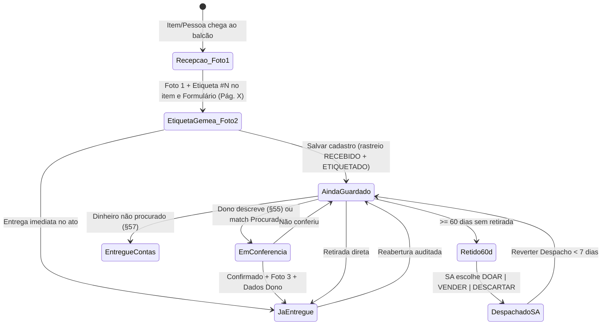
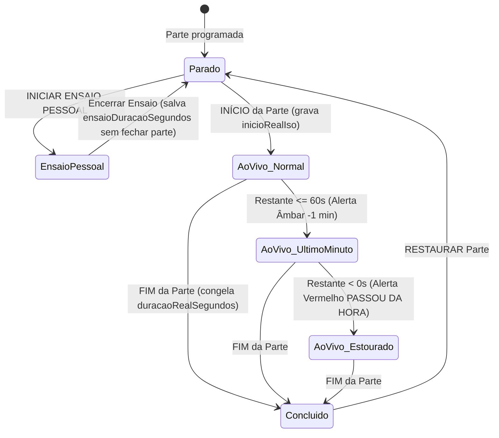
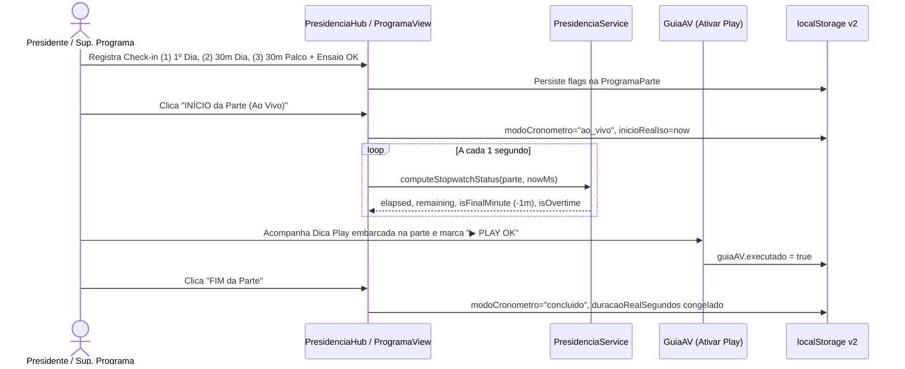
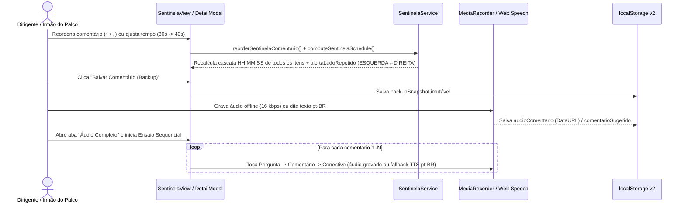
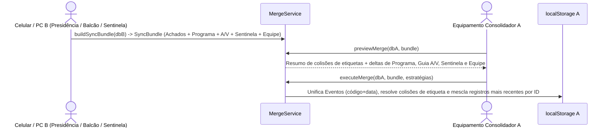
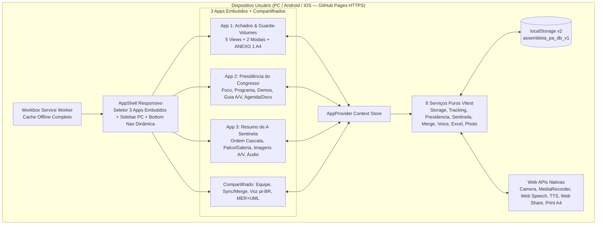

# UML — Modelagem Completa e Granular (Suíte Eventos — 3 Apps Embutidos)

Documentação UML atualizada cobrindo **Casos de Uso**, **Classes de Domínio e Serviços**, **Máquinas de Estados** (Item de Achados & Cronômetro Presidência), **Diagramas de Sequência** (Recepção Voz/Foto, Presidência Ao Vivo/A&V, Resumo de A Sentinela Cascata/Áudio e Mesclagem Multi-Dispositivo) e **Componentes PWA Offline-First**.

---

## 1. Diagrama de Casos de Uso (3 Apps Embutidos)

```mermaid
flowchart LR
    Vol([Voluntário Balcão])
    SA([Superint. Assembleia])
    Pres([Presidente / Sup. Programa])
    AV([Operador Áudio & Vídeo])
    Dir([Dirigente Sentinela / Palco])
    Dev([Outro Mobile / PC])

    subgraph Sys ["Suíte Eventos PWA (Offline-First • localStorage v2)"]
        subgraph App1 ["App 1 — Perdidos & Achados + Guarda-Volumes"]
            UC01[UC01 Gerir Eventos ABRIR/FECHAR + Convite]
            UC02[UC02 Cadastrar Item Foto1-Etiqueta-Foto2 §55-58]
            UC03[UC03 Busca, 5 Seções Glide, Conferência & Entrega]
            UC04[UC04 Itens Procurados & Cruzamento N:M]
            UC05[UC05 Deck Swipe Destinar SA >=60d + Reverter <7d]
            UC06[UC06 ANEXO 1 15l/pág + Relatório Final A4 + Excel/PA.txt]
        end

        subgraph App2 ["App 2 — Presidência do Congresso"]
            UC07[UC07 Painel Evento em Foco & Folha Sessão A4]
            UC08[UC08 Gerir Programa 3d×2t, Oradores & 3 Substitutos]
            UC09[UC09 Check-in 3 Etapas, Ensaio Palco & WhatsApp Sl 134:3]
            UC10[UC10 Cronômetro Dual-Mode Ao Vivo / Ensaio + Alertas -1m/Estouro]
            UC11[UC11 Gerir Demonstrações, Entrevistas & Experiências]
            UC12[UC12 Operar Guia Áudio & Vídeo com Dica Play e Ativar Play]
            UC13[UC13 Agenda, Lembretes RBAC 7 Perfis & Documentos Ref.]
        end

        subgraph App3 ["App 3 — Resumo de A Sentinela"]
            UC14[UC14 Gerir Estudo, Ordem de Entrada & Cascata 30s]
            UC15[UC15 Controlar Coreografia ESQUERDA/DIREITA/TRIBUNA & Galeria]
            UC16[UC16 Matriz de Substituições, Check-in 1º Dia & Ensaio 8:30]
            UC17[UC17 Operar Deck Imagens a Exibir A/V]
            UC18[UC18 Estúdio Áudio Offline, Salvar/Recuperar & Áudio Completo TTS]
            UC19[UC19 Mural Conversar Com Todos]
        end

        subgraph Shared ["Compartilhado"]
            UC20[UC20 Cadastro Unificado de Equipe & Voluntários]
            UC21[UC21 Comandos e Ditado por Voz pt-BR]
            UC22[UC22 Exportar/Mesclar JSON Multi-Dispositivo Todos os 3 Apps]
        end
    end

    Vol --> UC01 & UC02 & UC03 & UC04 & UC06 & UC21
    SA --> UC05 & UC06
    Pres --> UC01 & UC07 & UC08 & UC09 & UC10 & UC11 & UC13 & UC20 & UC21 & UC22
    AV --> UC12 & UC17 & UC13
    Dir --> UC14 & UC15 & UC16 & UC17 & UC18 & UC19 & UC20 & UC21
    Dev --> UC22
```

---

## 2. Diagrama de Classes (Domínio & 8 Serviços Puros)

```mermaid
classDiagram
    class AppDatabase {
      +number schemaVersion = 2
      +string activeEventoId
      +ConfiguracaoDispositivo config
      +Evento[] eventos
      +Item[] itens
      +ItemProcurado[] procurados
      +RelatorioFinal[] relatorios
      +Voluntario[] voluntarios
      +ProgramaParte[] programaPartes
      +ParticipacaoPrograma[] participacoes
      +GuiaAudioVideo[] guiaAV
      +LembreteAgenda[] lembretes
      +DocumentoReferencia[] referencias
      +SentinelaEstudo[] sentinelaEstudos
      +SentinelaComentario[] sentinelaComentarios
      +ConversaMensagem[] conversas
      +SyncLogEntry[] syncHistory
    }

    class StorageService {
      +loadDatabase() AppDatabase
      +saveDatabase(db) SaveResult
      +getStorageUsage() QuotaInfo
      +createDemoSeedData(config) DemoSeedResult
    }
    class TrackingService {
      +isRestrictedDisplay(item) boolean
      +isItemRetido(item, prazoDias) boolean
      +transitionItemToDelivered() TransitionResult
      +transitionItemToDispatchedSA() TransitionResult
      +transitionItemReopen() TransitionResult
    }
    class PresidenciaService {
      +deriveTurno(iso) TurnoCongresso
      +computeProgramEndTime(iso, min) string
      +sortProgramaPartes(list) ProgramaParte[]
      +requiresStageRehearsal(parte) boolean
      +computePresidenciaKpis(list) PresidenciaKpis
      +computeStopwatchStatus(parte, nowMs) StopwatchSnapshot
      +buildSpeakerWhatsappUrl(parte, tipo) string
      +extractSpeakerCloneFields(source) Partial
    }
    class SentinelaService {
      +sortSentinelaComentarios(list) SentinelaComentario[]
      +reorderSentinelaComentario(list, id, dir) SentinelaComentario[]
      +computeSentinelaSchedule(estudo, list) SentinelaScheduleSummary
      +createSentinelaBackup(com) SentinelaBackupSnapshot
      +restoreSentinelaFromBackup(com) SentinelaComentario
      +buildBackupCoverageMatrix(list) SubstituicaoGroup[]
      +buildSentinelaWhatsappUrl(com, est, dest, tipo) string
    }
    class MergeService {
      +buildSyncBundle(db, scope, evtId) SyncBundle
      +previewMerge(localDb, bundle) MergePreview
      +executeMerge(localDb, bundle, opts) MergeResult
    }
    class VoiceService {
      +parseVoiceCommand(raw, ctx) VoiceActionType
      +parseSpokenItemFields(raw, types) PartialItem
      +speakPtBr(text, enabled) void
    }
    class ExcelService {
      +importFromSpreadsheetBuffer() ExcelImportResult
      +exportToSpreadsheet() BlobFile
      +exportToAcrobatTxt() BlobFile
    }
    class PhotoService {
      +compressImageFile(file, opts) CompressedPhoto
    }

    StorageService --> AppDatabase
    MergeService --> AppDatabase
    MergeService --> TrackingService
    ExcelService --> AppDatabase
    PresidenciaService ..> AppDatabase
    SentinelaService ..> AppDatabase
    VoiceService ..> AppDatabase
    PhotoService ..> AppDatabase
```

---

## 3. Máquinas de Estados

### 3.1 Ciclo de Vida do Item (Perdidos e Achados)

### 3.2 Máquina de Estados — Cronômetro Dual-Mode da Presidência do Congresso

---

## 4. Diagramas de Sequência Granulares

### 4.1 Presidência — Check-in, Cronômetro Ao Vivo & Guia Áudio e Vídeo

### 4.2 Resumo de A Sentinela — Cascata de Horários, Palco & Áudio Completo

### 4.3 Mesclagem Multi-Dispositivo (Todos os 3 Apps Embutidos)

---

## 5. Diagrama de Componentes e Implantação PWA

