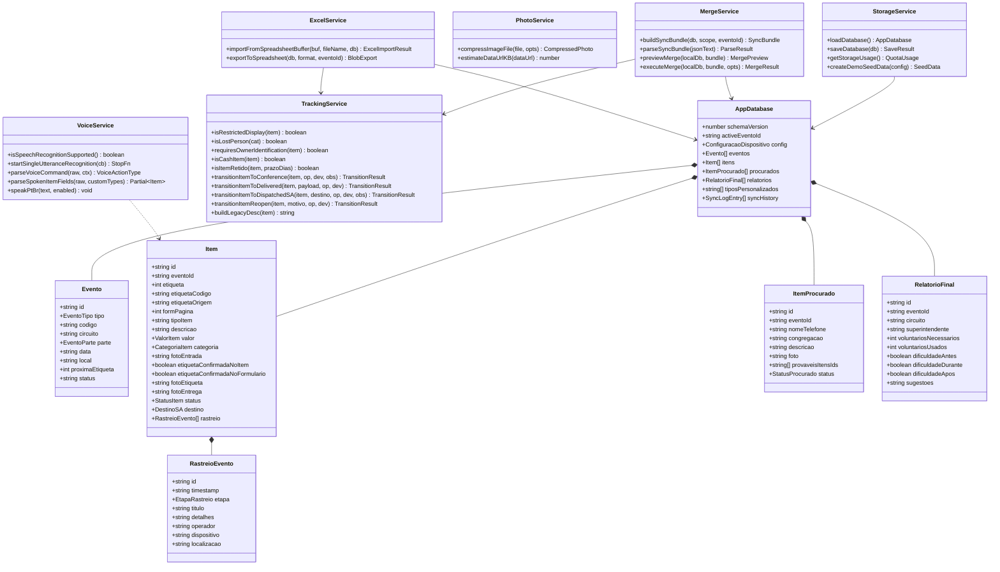
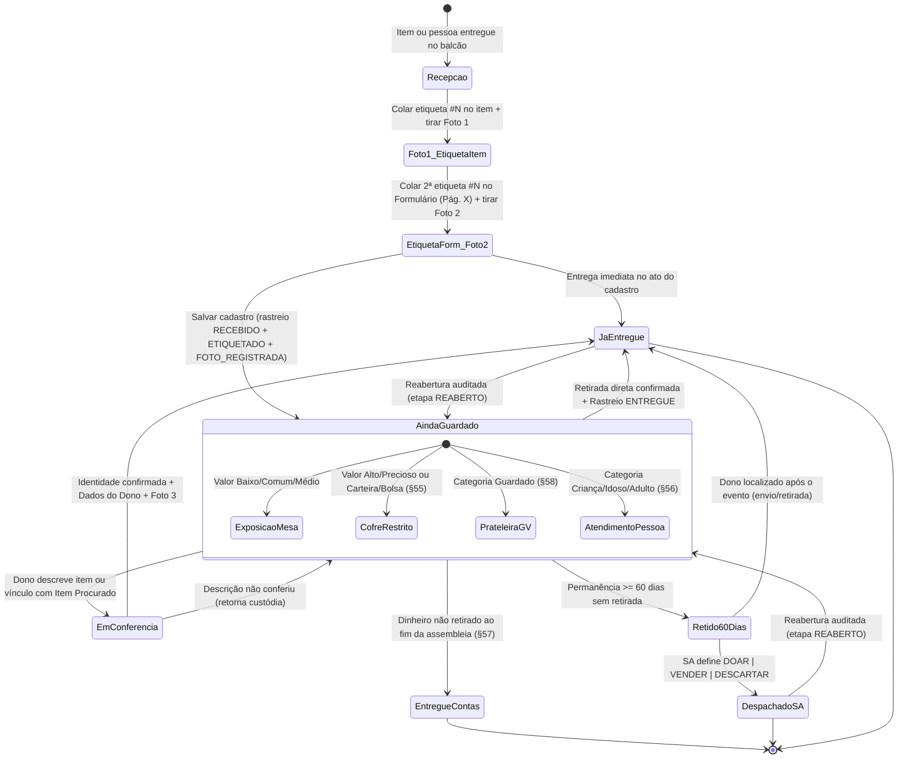
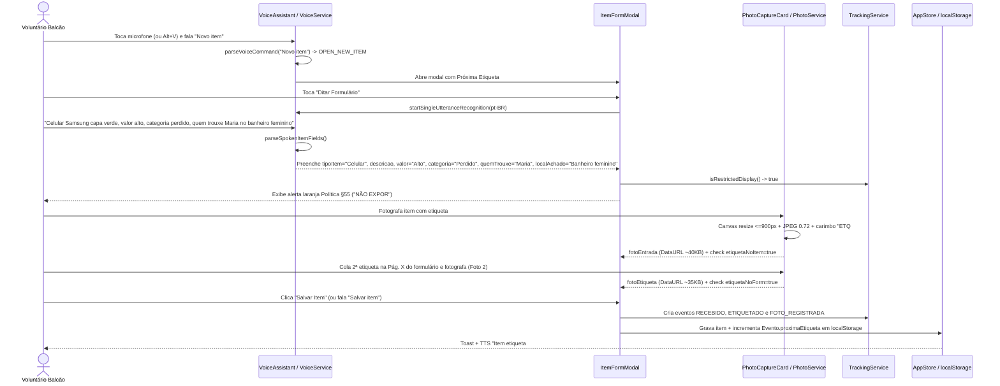
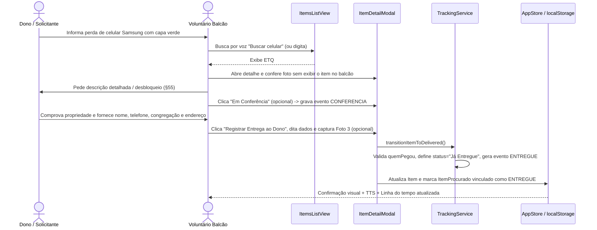
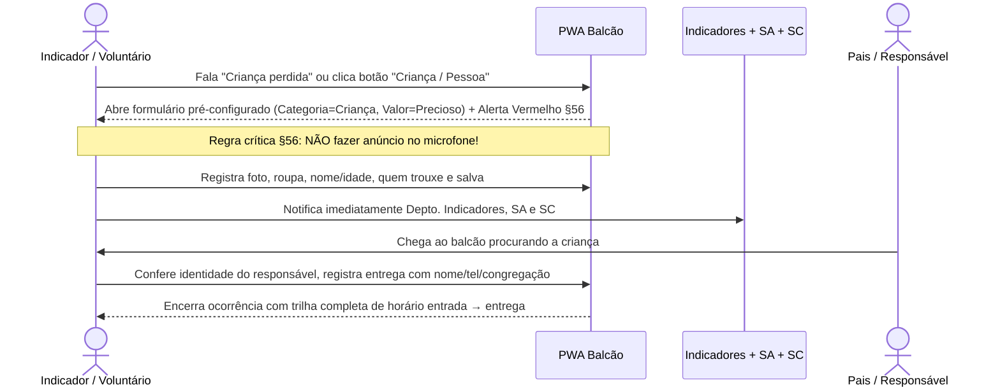
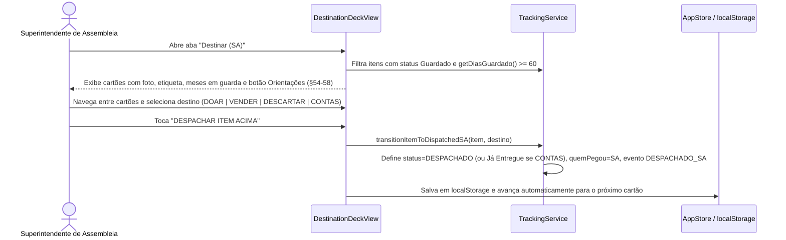
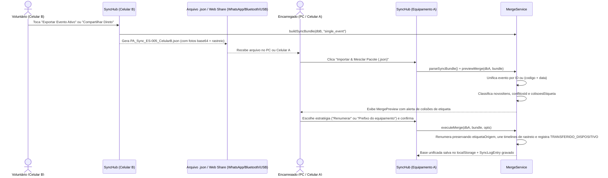
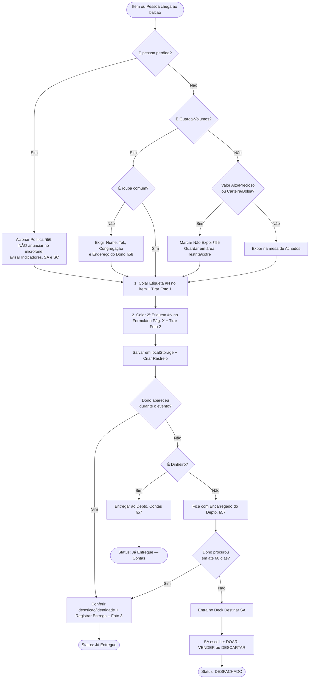
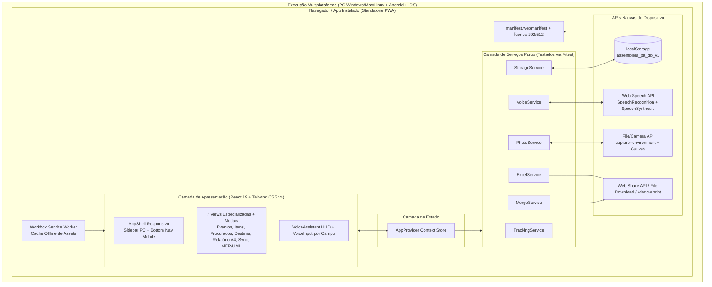

# UML — Modelagem Completa e Granular

Documentação UML completa cobrindo **Casos de Uso**, **Classes de Domínio e Serviços**, **Máquina de Estados do Ciclo de Vida**, **5 Diagramas de Sequência Granulares**, **Diagrama de Atividades Operacional** e **Diagrama de Componentes e Implantação PWA**.

---

## 1. Diagrama de Casos de Uso (Granular por Ator)

```mermaid
flowchart LR
    Vol([Voluntário do Balcão])
    Enc([Encarregado do Depto.])
    SA([Superintendente de Assembleia])
    Dono([Dono / Solicitante])
    Dev([Outro Mobile / PC])

    subgraph Sys ["PWA Perdidos e Achados & Guarda-Volumes"]
        subgraph ModEventos ["Módulo Eventos"]
            UC01[UC01 Selecionar Evento Ativo]
            UC02[UC02 Criar Evento Assembleia/Congresso com Código e Parte A/B]
            UC03[UC03 Consultar KPIs por Evento]
        end

        subgraph ModCustodia ["Módulo Recepção & Custódia"]
            UC04[UC04 Cadastrar Item: Foto 1 -> Etiqueta Gêmea -> Foto 2]
            UC05[UC05 Registrar Guarda-Volumes com Validação §58]
            UC06[UC06 Acionar Protocolo Pessoa/Criança Perdida §56]
            UC07[UC07 Aplicar Alerta de Item de Valor / Não Expor §55]
            UC08[UC08 Imprimir Par de Etiquetas Gêmeas]
        end

        subgraph ModCiclo ["Módulo Busca, Conferência & Entrega"]
            UC09[UC09 Buscar e Filtrar Itens por Etiqueta/Texto/Status/Restrito]
            UC10[UC10 Colocar Item Em Conferência com Solicitante]
            UC11[UC11 Registrar Entrega ao Dono com Foto 3 e Rastreio]
            UC12[UC12 Encaminhar Dinheiro ao Depto. de Contas §57]
            UC13[UC13 Reabrir Item Auditado no Rastreio]
        end

        subgraph ModProcurados ["Módulo Itens Procurados"]
            UC14[UC14 Cadastrar Solicitação de Item Procurado com Foto]
            UC15[UC15 Cruzar Similaridade Automática com Base Completa]
            UC16[UC16 Vincular Múltiplos Prováveis Itens Localizados]
        end

        subgraph ModSA ["Módulo Destinação SA & Relatório"]
            UC17[UC17 Avaliar Deck de Itens Retidos >= 60 dias]
            UC18[UC18 Despachar Item: Doar / Vender / Descartar / Contas]
            UC19[UC19 Preencher e Imprimir Relatório Final A4]
        end

        subgraph ModVozSync ["Acessibilidade por Voz & Multi-Dispositivo"]
            UC20[UC20 Navegar por Comandos de Voz pt-BR]
            UC21[UC21 Ditar Campos Individuais ou Frase Multi-Campo]
            UC22[UC22 Exportar/Compartilhar Pacote JSON com Fotos]
            UC23[UC23 Importar e Mesclar com Resolução de Colisões de Etiqueta]
            UC24[UC24 Importar e Exportar Planilha Excel .xlsx / .csv]
        end
    end

    Vol --> UC01 & UC03 & UC04 & UC05 & UC06 & UC07 & UC08 & UC09 & UC10 & UC11 & UC12 & UC14 & UC15 & UC16 & UC20 & UC21
    Enc --> UC01 & UC02 & UC13 & UC19 & UC22 & UC23 & UC24
    SA --> UC17 & UC18 & UC19
    Dono -.-> UC05 & UC10 & UC11 & UC14
    Dev --> UC22 & UC23
```

---

## 2. Diagrama de Classes (Domínio, Estado e Serviços)

---

## 3. Máquina de Estados — Ciclo de Vida Completo do Item

---

## 4. Diagramas de Sequência Granulares

### 4.1 Sequência A — Recepção com Acessibilidade por Voz + Foto • Etiqueta • Foto

### 4.2 Sequência B — Busca, Conferência e Entrega ao Dono com Comprovação

### 4.3 Sequência C — Fluxo Emergencial de Criança / Pessoa Perdida (§56)

### 4.4 Sequência D — Destinação Pós-Evento de Itens Retidos (>60 dias) pelo SA

### 4.5 Sequência E — Exportação, Importação e Mesclagem Multi-Dispositivo

---

## 5. Diagrama de Atividades Operacional (Fluxo de Decisão do Balcão)

---

## 6. Diagrama de Componentes e Implantação PWA

